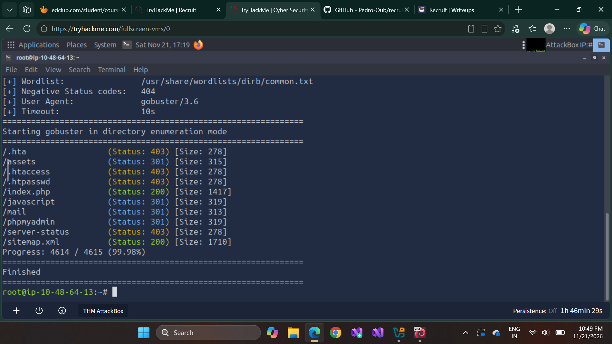
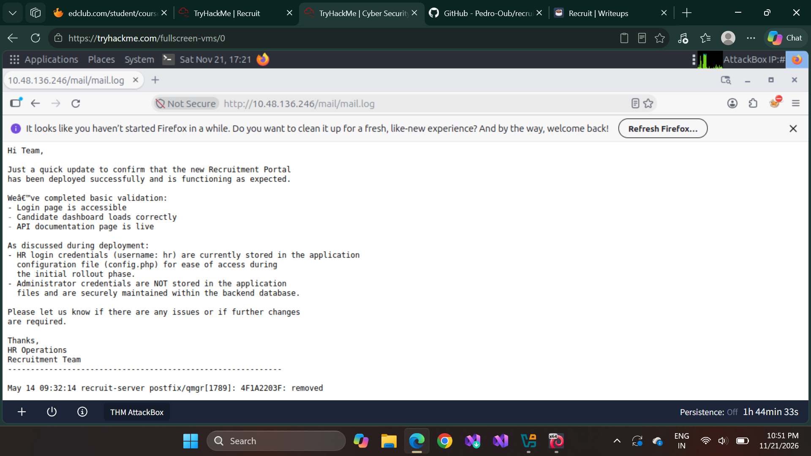
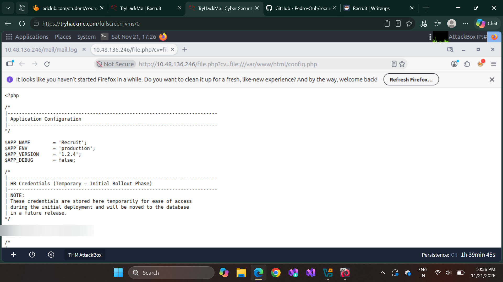
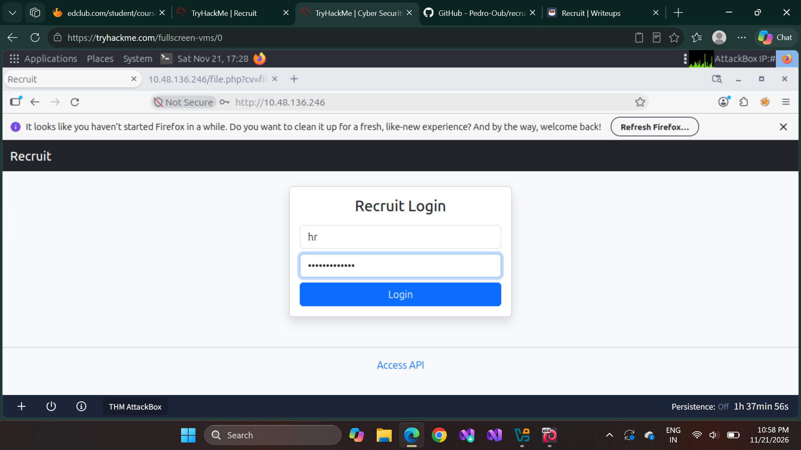
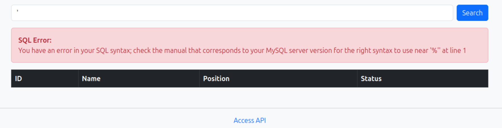
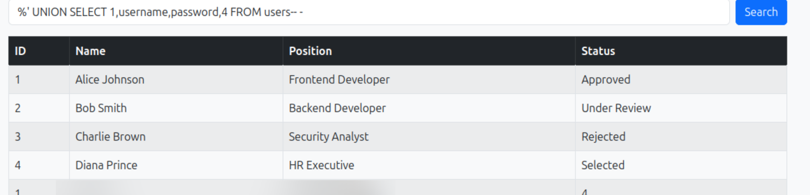
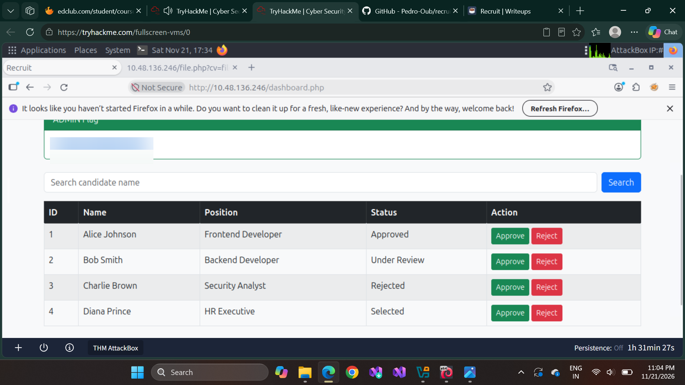

# TryHackMe — Recruit | Web Vulnerabilities Writeup

**Room:** Recruit (Web Fundamentals / Web Vuln series)
**Difficulty:** Easy
**Category:** Web Application Penetration Testing
**Author:** _your name / handle_
**Date:** November 2026

---

## 1. Executive Summary

The "Recruit" box hosts a fictional company's internal recruitment portal. During testing, a chain of six distinct vulnerabilities was identified that, when combined, allowed an unauthenticated attacker to escalate from basic reconnaissance to full **administrative access** over the application and its underlying database.

No single flaw was catastrophic in isolation — the real lesson of this box is how **small information leaks compound**. A forgotten log file led to a config file path, the config file leaked a password, that password unlocked a low-privilege account, and a SQL injection in that account's own search feature leaked the admin's credentials outright.

| # | Vulnerability | Impact |
|---|---|---|
| 1 | Information Disclosure | Leaked the location/existence of credential storage |
| 2 | Local File Inclusion (LFI) | Exposure of sensitive server-side files |
| 3 | Hardcoded Credentials | Weak security practice / direct credential leak |
| 4 | SQL Injection | Full database compromise |
| 5 | Broken Access Control | Privilege escalation to admin |

*(SSRF is noted as a related risk — `file.php?cv=` accepts arbitrary URIs including the `file://` wrapper, which is the entry point LFI was exploited through; see §4.2.)*

**Final flag:** `THM{████████████████}` *(redacted — see note below)*

---

## 2. Scope & Objective

- **Target:** `http://10.48.136.246` (TryHackMe "Recruit" AttackBox VM)
- **Objective:** Identify and chain web application vulnerabilities to gain administrative access to the Recruit portal and retrieve the flag.
- **Rules of engagement:** Authorized TryHackMe lab environment only. No real systems were tested.

---

## 3. Tools Used

| Tool | Purpose |
|---|---|
| Gobuster | Directory/file enumeration |
| Firefox (AttackBox) | Manual browsing & request crafting |
| Burp Suite *(optional)* | Intercepting/replaying requests |
| Manual SQL injection | Database enumeration |

---

## 4. Methodology — The Attack Chain

The attack chain below is the backbone of this report. Each stage feeds directly into the next.

```
Recon (Gobuster)
      │
      ▼
[1] Information Disclosure  →  /mail/mail.log reveals config.php stores HR creds
      │
      ▼
[2] Local File Inclusion    →  file.php?cv=file:///var/www/html/config.php
      │
      ▼
[3] Hardcoded Credentials   →  config.php leaks $HR_PASSWORD
      │
      ▼
      Authenticate as "hr" on the Recruit login page
      │
      ▼
[4] SQL Injection           →  UNION-based injection in candidate search
      │
      ▼
[5] Broken Access Control   →  Leaked admin credentials grant full admin dashboard
      │
      ▼
                       FLAG CAPTURED
```

---

### 4.1 Information Disclosure — Exposed Mail Log

**Vulnerability:** Information Disclosure
**Impact:** Leaked credentials location

**Steps:**
1. Ran a directory brute-force scan against the web root using Gobuster with the `dirb/common.txt` wordlist:

   ```
   gobuster dir -u http://10.48.136.246 -w /usr/share/wordlists/dirb/common.txt
   ```

   

   This surfaced several directories and files, including `/mail`, `/phpmyadmin`, `/javascript`, `/assets`, `/sitemap.xml` and `/index.php`.

2. Browsing to `/mail/mail.log` exposed a plaintext internal email thread from "HR Operations" confirming the new portal's deployment. Critically, the email states:

   > HR login credentials (username: `hr`) are currently stored in the application configuration file (`config.php`) for ease of access during the initial rollout phase.

   

**Why this matters:** This single exposed log file did not leak a password directly, but it told an attacker *exactly where to look next* — turning a blind search into a targeted one. This is a textbook example of how "low severity" information disclosure accelerates a real attack chain.

---

### 4.2 Local File Inclusion (and SSRF entry point) — Reading `config.php`

**Vulnerability:** Local File Inclusion (via an SSRF-style file-fetching parameter)
**Impact:** Exposure of sensitive files

**Steps:**
1. Further enumeration/application review revealed a `file.php` endpoint that accepts a `cv` parameter intended to fetch a candidate's uploaded CV/resume — but it does not restrict the scheme or path supplied.
2. Because the parameter accepts arbitrary URIs (including the `file://` wrapper), it can be abused for **Server-Side Request Forgery** against the local filesystem, which in practice functions as a **Local File Inclusion** vulnerability. The mail log pointed directly at the target file:

   ```
   http://10.48.136.246/file.php?cv=file:///var/www/html/config.php
   ```

   

3. The application returned the raw PHP source of `config.php` instead of executing it, exposing internal application configuration.

**Why this matters:** Any parameter that accepts a user-controlled path or URI for "fetching a file" needs strict allow-listing. Here it allowed reading arbitrary files on the server, including configuration files never meant to be publicly reachable.

---

### 4.3 Hardcoded Credentials — Plaintext Password in Source

**Vulnerability:** Hardcoded Credentials
**Impact:** Weak security practice (direct credential disclosure)

**Finding:** The leaked `config.php` contained a hardcoded HR password in plaintext, with a comment acknowledging this was a temporary, insecure practice:

```php
/*
|--------------------------------------------------------------------
| HR Credentials (Temporary – Initial Rollout Phase)
|--------------------------------------------------------------------
| NOTE:
| These credentials are stored here temporarily for ease of access
| during the initial deployment and will be moved to the database
| in a future release.
*/

$HR_PASSWORD = '████████████';
```


**Credentials recovered:**

| Username | Password |
|---|---|
| `hr` | `████████████` *(redacted)* |

These credentials were used to authenticate on the Recruit login page:



**Why this matters:** Hardcoding secrets in source files — even "temporarily" — is one of the most common real-world root causes of breaches, because "temporary" code has a well-documented habit of making it to production and staying there.

---

### 4.4 SQL Injection — Candidate Search

**Vulnerability:** SQL Injection
**Impact:** Full database compromise

**Steps:**
1. After logging in as `hr`, the dashboard exposed a candidate search feature. Submitting a single quote (`'`) triggered a raw MySQL syntax error, confirming the input was unsanitized and concatenated directly into a query:

   

   ```
   SQL Error:
   You have an error in your SQL syntax; check the manual that corresponds
   to your MySQL server version for the right syntax to use near '%'' at line 1
   ```

   The error also reveals the query wraps input in `%...%` — i.e. a `LIKE '%INPUT%'` clause — which shapes the injection payload below.

2. Built a UNION-based injection to pull usernames and passwords out of the `users` table, matching the query's column count and closing the trailing `%`:

   ```sql
   %' UNION SELECT 1,username,password,4 FROM users-- -
   ```

   

3. This returned the application's normal candidate rows **plus** an injected row revealing admin credentials:

   | ID | Name | Position/Username | Status/Password |
   |---|---|---|---|
   | 1 | admin | `████████████` *(redacted)* | *(hash/value, redacted)* |

**Why this matters:** This is a classic UNION-based SQL injection — unsanitized user input reaching the database layer allowed an attacker to read *any* table, not just the ones the application intended to expose. A single search box became a full database read primitive.

---

### 4.5 Broken Access Control — Privilege Escalation to Admin

**Vulnerability:** Broken Access Control
**Impact:** Privilege escalation

**Steps:**
1. Using the admin credentials recovered via SQL injection, re-authenticated to the portal.
2. The dashboard now rendered administrative functionality that should never be reachable by an HR-level or unauthenticated actor — including an **Admin Flag** banner and full **Approve/Reject** controls over every candidate record:

   

3. Flag captured:

   ```
   THM{████████████████}
   ```
   *(Redacted — TryHackMe asks that room flags not be posted publicly. If this repo is private or the room is marked complete, feel free to un-redact it locally.)*

**Why this matters:** The application made an implicit trust assumption — that only someone who already "knew" the admin password could reach this view — rather than enforcing role checks server-side per request. Once any credential-leak vector exists upstream (and here there were several), that assumption collapses.

> **Note on redactions:** Credentials and the flag are blurred/redacted in this writeup and its screenshots. This is standard practice for public TryHackMe writeups — it lets you demonstrate methodology without handing out working answers to a room others are still solving.

---

## 5. Full Attack Narrative (Recap)

1. **Enumeration** with Gobuster uncovered hidden endpoints, including a `/mail` directory.
2. **Information Disclosure**: `mail.log` revealed that HR credentials were stored in `config.php`.
3. **LFI/SSRF**: `file.php?cv=file:///var/www/html/config.php` was used to read that file directly.
4. **Hardcoded Credentials**: the file contained a plaintext HR password, used to log in as `hr`.
5. **SQL Injection**: the authenticated candidate-search feature was vulnerable to UNION-based SQLi, dumping the `users` table and recovering admin credentials.
6. **Broken Access Control**: logging in as admin exposed a privileged dashboard with no further verification, yielding the final flag.

---

## 6. Remediation Recommendations

| Vulnerability | Recommendation |
|---|---|
| Information Disclosure | Remove debug/log files from web-accessible directories; disable directory listing; restrict `/mail`, `/assets`, `/javascript` etc. at the webserver level |
| LFI / SSRF | Never accept a user-controlled URI/path for file operations; allow-list specific files/IDs server-side instead of raw paths; disable dangerous URI wrappers (`file://`, `php://`, etc.) |
| Hardcoded Credentials | Never store credentials in source files, even "temporarily"; use environment variables or a secrets manager; rotate any credential that was ever hardcoded |
| SQL Injection | Use parameterized queries / prepared statements exclusively; never concatenate user input into SQL; apply least-privilege DB accounts |
| Broken Access Control | Enforce role checks server-side on every request to privileged endpoints, not just at login; use session-based authorization checks, not "if you have the password you're in" |

---

## 7. Conclusion

The Recruit room is a strong beginner-friendly demonstration of **vulnerability chaining**: no single bug here required advanced exploitation skill, but the cumulative effect of six interrelated weaknesses allowed a full compromise from zero knowledge of the application. It's a good reminder that "low" and "medium" severity findings should never be dismissed in isolation — real attackers chain exactly what this report chains.

**Flag:** `THM{████████████████}` *(redacted for public posting)*

---

## Appendix: Screenshot Index

Save your screenshots into a `screenshots/` folder alongside this file, using these filenames (or update the links above to match your own naming):

| File | Description |
|---|---|
| `01-gobuster-scan.png` | Gobuster directory enumeration results |
| `02-mail-log.png` | Exposed `/mail/mail.log` revealing credential storage location |
| `03-lfi-config.png` | `config.php` contents read via LFI, showing hardcoded HR password |
| `04-login-page.png` | Recruit login page with recovered HR credentials |
| `05-sql-error.png` | SQL syntax error confirming injection point |
| `06-sqli-union.png` | UNION-based SQLi dumping admin credentials |
| `07-admin-dashboard.png` | Admin dashboard with flag and privilege-escalated controls |
